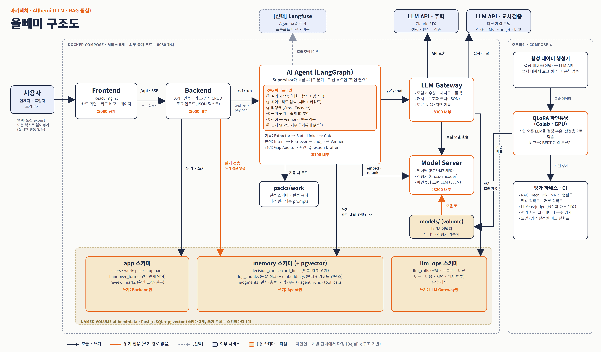

# Allbemi (올빼미) 기획서

> **모든(All) 업무 기록의 이유를 품는 올빼미.**
> 업무 대화·메모에서 **결정 카드**(결정 · 근거 · 버린 대안 · 상태)를 자동으로 만들고, 새 계획을 입력하면 기존 결정과 나란히 비교해 **일치 / 충돌 / 기각된 안**을 판정하며, 인수인계 때 빠진 결정을 찾아 주는 **LLM · RAG 기반 멀티 에이전트 서비스**.

> 상태: **기획 단계 (폴더 구조 기본 틀만 있음)**. 다음 단계는 프론트엔드 목업이고, 코드는 주차별로 채웁니다.

---

## 1. 서비스 개요

| 항목 | 내용 |
|---|---|
| **서비스명** | **Allbemi** (All + 올빼미). 모든(All) 업무 기록의 이유를 품는 올빼미 |
| **한 줄 정의** | 업무 대화·메모에서 결정 카드를 자동 생성하고, 새 계획을 기존 결정과 비교해 판정하며, 인수인계 때 빠진 결정을 찾아 주는 서비스 |
| **차별점** | 기존 AI 검색은 무엇을 물어야 할지 알아야 답이 나오지만, Allbemi는 **하려는 일을 입력하면 과거에 기각된 안인지 먼저 알려 줍니다.** |
| **화면 원칙** | **카드가 화면의 중심이고, 채팅창이 중심이 아닙니다.** 질문 기능은 카드 화면 안의 보조 도구입니다. |
| **기술 중심** | **LLM**(역할별 모델 분리, LLM Gateway, 소형 LLM 파인튜닝)과 **RAG**(하이브리드 검색, 청킹 비교 실험, parent-child, 인용 검증)가 서비스의 핵심 |
| **프로젝트 성격** | 개인 프로젝트, 1인 6주(약 1달 반), LLM 엔지니어 취업 포트폴리오 목적 |

---

## 2. 해결할 문제

핵심은 **인수인계에서 "결과"만 전달되고 "이유"는 사라진다**는 것입니다.

| 문제 | 설명 |
|---|---|
| 이유 없는 인수인계 | 문서에는 "무엇을 쓰는지"만 있고 "왜 정했는지, 어떤 대안을 버렸는지"는 빠짐 |
| 같은 시행착오 반복 | 후임자가 이미 기각된 안을 모르고 다시 제안하고, 한참 뒤에야 알게 됨 |
| 이유가 흩어지고 사라짐 | 슬랙, 회의, 담당자 머릿속에만 있다가 퇴사·이동과 함께 사라짐 |
| 몰아 쓰기의 한계 | 인계 시점에 몰아 쓰면 몇 달 전 결정의 이유를 잊고 일부를 빠뜨림 |
| 기존 도구의 한계 | 결정 기록 도구는 직접 등록해야 해서 바쁘면 중단되고, AI 챗봇은 무엇을 물어야 할지 알아야 하며 기각된 안을 먼저 알려 주지 않음 |
| 자동 생성의 신뢰 문제 | 자동 결과는 틀릴 수 있어서 확신도 표시와 사람 확인 단계가 필요함 |

### 페르소나

| 구분 | 인물 | 상황과 목표 |
|---|---|---|
| **인계자** | 박민준, 31세 백엔드 개발자 | 다음 달 다른 프로젝트로 이동. 슬랙과 짧은 메모로 소통하고 별도 문서는 미루는 편. 부담 없이 기록하고 빠짐없이 이유까지 넘기고 싶음 |
| **후임자** | 이서연, 27세 개발자 | 프로젝트를 처음 이어받음. 어떤 결정이 왜 내려졌는지 모르고, 모르고 한 제안이 이미 기각된 안일까 불안함 |

---

## 3. 주요 기능

### 3-1. 카드 한 장의 구성

- 결정 내용, 근거, **검토 후 버린 대안**, 담당자, 날짜
- **상태**: 현재 유효 / 폐기 / 새 결정으로 대체
- **원문 보기**: 근거가 된 실제 대화·메모를 펼쳐서 확인
- **확신도 표시**: 불확실하면 "확인 필요"
- **카드 덱**: 프로젝트별 카드 묶음. 인수인계는 "덱을 넘겨주는 일"

### 3-2. 두 카드를 나란히 놓는 세 장면

| 장면 | 사용자 | 내용 |
|---|---|---|
| **① 내 계획 vs 전임자 카드** | 후임자 | "로그 검색용으로 MongoDB 도입해 볼까"를 입력하면 왼쪽에 내 입력 카드, 오른쪽에 관련 전임자 카드가 나란히 뜨고 두 카드 사이에 **판정 배지**가 붙음 |
| **② 평소 기록 vs 인수인계 양식** | 인계자 | "점검"을 누르면 양식에 반영되지 않은 로그 카드는 **빈 자리**로, 내용이 다르면 로그 카드와 양식 카드가 나란히 표시됨. 상단에 완성도(예: 핵심 결정 30장 중 27장 반영) |
| **③ 인수인계 확인** | 후임자 | 덱의 카드를 한 장씩 넘기며 "이해함 / 질문 있음" 표시. 진행 바가 올라가고(예: 12장 중 8장), 질문 있음 카드는 인계자에게 전달할 **질문 목록**으로 모임 |

### 3-3. 판정 배지 (장면 ①)

| 배지 | 의미 |
|---|---|
| ✅ 일치 | 현재 유효한 결정과 같은 방향 |
| ⚠ 충돌 | 현재 유효한 결정과 반대 방향 |
| 🚫 기각된 안 | 과거에 검토 후 버린 안을 다시 꺼냄 (기각 이유 함께 표시) |
| ➖ 관련 없음 | 해당하는 카드 없음 |

### 3-4. 기본 기능과 시각화

| 기능 | 내용 |
|---|---|
| 데일리 로그 작성 | 오늘의 업무 대화·메모를 자유 형식으로 붙여넣으면 카드가 자동 생성 (형식 불필요) |
| 카드 확인·수정 | 자동 생성된 카드를 고침. 자신 없는 카드는 "확인 필요" |
| 인수인계 양식 | 결정, 근거, 현재 상태, 인수자 메모를 정해진 항목으로 작성 |
| 카드 덱 보기 | 프로젝트별 목록, 상태별 구분, 시간순 정렬 |
| 카드 기반 질문 | "이 결정은 왜 했지?"에 관련 카드와 원문을 근거로 답하고, 기록에 없으면 "기록에 없음" |
| 상태 시각화 | 유효=초록, 폐기=회색 취소선, 대체=새 카드로 이어지는 화살표 |
| 재미 요소(과하지 않게) | 카드가 뒤집히며 생성되는 효과, "확인함" 도장, 완성도 게이지가 차는 변화, 카드 넘기기 |

**일부러 넣지 않는 것**: 점수, 랭킹, 수집 배지 같은 게임 요소
**만들지 않는 기능**: 승인·마감 워크플로우, 슬랙 실시간 연동, 회의 녹음 전사, 권한 관리, 전사 통합 검색

---

## 4. 사용 흐름

| 시점 | 사람 | 하는 일 | 화면에서 보는 것 |
|---|---|---|---|
| 평소 | 민준 | 퇴근 전 업무 대화·메모를 붙여넣기 | 결정 카드가 자동 생성, 확인 필요 카드 표시 |
| 이동 전 | 민준 | 인수인계 양식 작성 후 "점검" | 빈 자리 카드, 불일치 카드, 완성도 게이지 |
| 이동 전 | 민준 | 빠진 결정 보강 후 인계 완료 | 완성도 상승, 덱이 후임에게 넘어감 |
| 인수 후 | 서연 | 덱을 한 장씩 넘기며 "이해함 / 질문 있음" | 확인 진행 바, 질문 목록 |
| 업무 중 | 서연 | 하려는 일 입력 (예: "MongoDB 도입해 볼까") | 내 카드와 전임자 카드가 나란히, 🚫 기각된 안 배지 |
| 필요할 때 | 서연 | "이 결정은 왜 했지?" 질문 | 카드와 원문을 근거로 한 답변, 없으면 "기록에 없음" |

---

## 5. LLM 설계

한 모델에 모든 일을 맡기지 않고 **역할마다 다른 모델**을 쓰고, 그 선택을 **같은 평가셋으로 비교해서 정합니다.** 아래 모델 계열은 후보이며 최신 버전과 라이선스는 도입 시점에 확인합니다.

### 5-1. 역할별 모델

| 역할 | 모델 | 이유 |
|---|---|---|
| **주력 생성·판정·검증** (판정 설명, 인수인계서, Verifier) | Claude Sonnet 5.5 | 품질과 비용의 균형, 구조화 출력·도구 사용 |
| **대량·저비용 작업** (합성 데이터 일부, 질의 재작성, 보조 분류) | Claude Haiku 5.5 | 호출이 많은 단계의 비용 절감 |
| **교차검증·평가 심사(LLM-as-judge)** | 다른 계열의 API 모델 | 생성 모델과 같은 계열이 심사하면 자기 출력을 후하게 평가하는 편향이 생길 수 있어 분리 |
| **직접 파인튜닝하는 소형 LLM** (결정 추출, 판정) | 소형 오픈 모델(1~8B급, Qwen · Gemma · EXAONE 계열 중 비교 후 선택) | 한국어 성능, 라이선스, Colab에서 QLoRA 가능한 크기 |
| **임베딩** | BGE-M3 계열 등 한국어 임베딩 3종 비교 | 다국어·한국어 지원 |
| **리랭커** | bge-reranker-v2-m3 계열 (Cross-Encoder) | 검색 결과 재정렬 |
| **비교군(baseline)** | KLUE-RoBERTa 등 BERT 계열 분류기 | "LLM 파인튜닝이 정말 이득인가"를 보여주는 기준선 |

### 5-2. LLM Gateway

| 기능 | 내용 |
|---|---|
| 모델 라우팅 | 작업 종류에 따라 Sonnet / Haiku / 로컬 소형 LLM 선택 |
| 재시도·폴백 | 실패하면 재시도, 계속 실패하면 다른 모델로 |
| 구조화 출력 | JSON 스키마를 강제하고 검증 실패 시 자동 재요청 |
| 캐시 | 같은 요청은 재호출하지 않고 비용 절감 |
| 호출 기록 | 모델, 프롬프트 버전, 토큰, 비용, 지연 시간을 `llm_ops` 스키마에 기록 |

### 5-3. LLM 실험 방식 (작은 것부터 → 비교 → 약점 분석 → 개선 → 정량 평가 → 리포트)

| 단계 | 내용 |
|---|---|
| **서비스 니즈에 맞는 지표 선택** | **"기각된 안·충돌" 재현율(recall)이 최우선.** 놓치면 후임자가 이미 기각된 안을 다시 시도하는 것이 가장 치명적입니다. 오탐(잘못된 🚫)은 "확인 필요"와 사용자 수정으로 흡수할 수 있습니다. |
| **후보 모델 5개 비교** | ① Claude Sonnet 5.5 zero-shot ② Haiku 5.5 ③ 다른 계열 API ④ 소형 오픈 LLM 원본 ⑤ BERT 분류기. 같은 평가셋에서 재현율 중심으로 순위를 매김 |
| **CPU vs GPU 속도 비교** | 로컬 임베딩·리랭커·소형 LLM 추론 속도 비교 (서비스에서 어디까지 GPU가 필요한지 판단) |
| **약점 분석 → 파인튜닝** | 1차 평가에서 틀린 사례를 분석(완곡한 기각 표현, 암시적 대안, 여러 번 번복, 긴 스레드)하고 **그런 사례 위주로 학습데이터를 선별**해 소형 LLM을 QLoRA로 파인튜닝. **원본 vs 파인튜닝을 같은 평가셋으로 비교** |
| **전후처리 선정** | 후보를 하나씩 적용하며 효과를 측정(ablation)해 최종 조합 선정 (아래 표) |
| **서빙 최적화·부하 테스트** | 로컬 모델을 vLLM 등으로 서빙하고 응답 시간(p50·p95), 처리량, 호출당 비용 측정 |

| 구분 | 전후처리 후보 |
|---|---|
| **전처리** | 슬랙 말투·이모지·멘션 정규화, 같은 스레드 묶기, 화자·날짜 정규화, 중복·잡담 제거, 긴 스레드 분할 |
| **후처리** | JSON 스키마 검증과 자동 재요청, 근거 없는 판정 강등 규칙, 확신도 임계값 조정, 번복 규칙 보정, 인용이 없으면 거부 |

---

## 6. RAG 설계

### 6-1. RAG가 쓰이는 곳

| 쓰이는 곳 | 하는 일 |
|---|---|
| **판정 흐름 (Judge)** | 사용자가 입력한 계획과 관련된 과거 카드·기각된 대안을 검색해 일치/충돌/기각/무관을 판정 |
| **카드 기반 질문 (Grounded QA)** | 관련 카드와 원문을 검색해 출처와 함께 답변, 근거가 없으면 거부 |
| **State Linker** | 새 결정이 기존 결정을 번복·대체하는지 판단하기 위해 관련 과거 카드 검색 |
| **Gap Auditor** | 인수인계 양식 항목과 평소 로그 카드를 매칭 |

### 6-2. 파이프라인 (AI Agent 안의 6단계)

| 단계 | 내용 |
|---|---|
| ① 질의 재작성 | 짧은 입력("MongoDB 도입해 볼까")을 검색에 맞는 질의로 확장 |
| ② 하이브리드 검색 | 벡터 검색 + 키워드 검색을 함께 사용 |
| ③ 리랭크 | Cross-Encoder로 상위 후보 재정렬 |
| ④ 근거 묶기 | 카드마다 출처 ID를 붙여 프롬프트에 넣음 |
| ⑤ 생성과 인용 검증 | 답변 생성 후 Verifier가 "인용한 근거가 실제로 그 말을 하는가" 확인 |
| ⑥ 거부 | 근거가 충분하지 않으면 "기록에 없음" |

### 6-3. 인덱스 설계 (Allbemi의 특징)

- **두 종류를 따로 색인**: 결정 카드(구조화된 필드별)와 원문 로그 청크(대화 흐름 기준으로 자른 조각). 카드에서 원문으로 이어지는 연결을 유지합니다.
- **폐기·대체된 카드도 검색 대상에 포함**합니다. "기각된 안"을 찾으려면 폐기 카드가 검색에서 빠지면 안 되고, 상태를 메타데이터로 붙여 답변에서 구분합니다.
- **카드 간 관계(`card_links`)로 이웃 확장**: 검색된 카드의 번복·대체 관계를 따라 연결된 카드를 함께 가져옵니다.

### 6-4. RAG 실험 방식 (가장 단순한 baseline → 청킹 다양화 → 고도화 → 정량 평가)

| 단계 | 내용 |
|---|---|
| **R1. baseline** | 원문 로그를 fixed-length로 자르고 가벼운 한국어 임베딩으로 색인, 자연어 검색창에서 유사한 순 5개 표시 (개발용 "RAG Lab" 화면) |
| **R2. 청킹 5종 비교** | fixed 300 · fixed 150 · recursive · semantic · structured(스레드·화자·섹션 구조 기준). 각각 별도 색인하고 **같은 질문의 결과를 한 화면에서 나란히 비교**하는 "Chunking Lab" |
| **R3. 고도화** | ① **제목 임베딩**: 청크마다 한 줄 제목(결정 헤드라인)을 LLM으로 생성해 함께 임베딩, 제목이 검색되면 연결된 원문 청크를 반환 ② **parent-child**: 작은 청크(150자)로 검색하고 그 청크가 속한 논의 구간(스레드 전체)을 반환 ③ **LLM 의미 단위 청킹**: 한 결정이 논의된 대화 구간("결정 에피소드") 단위로 분할 |
| **R4. 정량 평가** | 정성 평가로 고른 청킹 3종 × 한국어 임베딩 3종 = **9케이스**를 평가 |

### 6-5. 평가 질문과 지표

**청크당 질문 3종** (서비스의 실제 사용 방식 반영)

| 질문 유형 | 예 |
|---|---|
| ① 이유를 묻는 질문 | "검색 서버를 왜 Elasticsearch로 정했지?" |
| ② **계획형 질문** (장면 ①과 동일) | "로그 검색용으로 MongoDB 도입해 볼까" |
| ③ 모호하거나 축약된 질문 | "그때 로그 쪽 결정 뭐였지?" |

**지표**: hit rate@k, MRR(정답 순위가 높을수록 점수↑), recall@k, precision@k, nDCG, MAP, 검색 지연 시간, 색인 크기·비용, 그리고 **Allbemi 전용 지표**

| 전용 지표 | 이유 |
|---|---|
| **기각된 대안 검색 재현율** | 폐기·기각된 카드를 찾아내는지가 서비스 핵심 |
| **상태 구분 정확도** | 검색 결과에서 유효·폐기·대체를 올바르게 구분하는지 |
| **parent 반환 적합도** | 부모 구간이 질문에 충분한 맥락을 주는지 |
| 이웃 확장 효과 | `card_links`로 연결 카드를 가져올 때의 개선 |

**평가셋 품질 주의**: 청크에서 질문을 생성하면 청크의 단어를 그대로 베껴 키워드가 겹쳐 점수가 부풀 수 있으므로, 바꿔 말하도록 지시하고 일부를 직접 검수합니다. 학습 데이터와 평가 데이터는 완전히 분리하고 평가셋은 수정하지 않습니다.

### 6-4. 벡터 DB

| 선택 | 장점 | 단점 |
|---|---|---|
| **랩은 Chroma, 서비스는 pgvector** (현재 추천) | 실험이 빠르고 서비스는 DB 하나로 단순 | 승격할 때 옮기는 작업 |
| 처음부터 pgvector만 | 한 번에 통일 | 실험용 컬렉션을 여러 개 만들 때 약간 번거로움 |

---

## 7. 에이전트 평가

- **LLM-as-judge**로 평가하되, **생성 모델과 다른 계열**을 쓰고 일부는 사람이 검수해 심사 모델과의 일치도를 확인합니다.
- 일반적으로 쓰는 에이전트 평가 지표를 조사한 뒤 서비스에 맞는 지표를 선정합니다. 도구는 ragas · LangChain 평가 도구를 기본으로 하고, 고유 지표는 직접 구현합니다. (한국어에서 점수가 안정적인지 확인 필요)

| 지표 | 의미 |
|---|---|
| **판정 정확도** | 4분류(일치·충돌·기각·무관) macro-F1, **기각·충돌 재현율(핵심)** |
| 라우팅 정확도 | Supervisor가 요청에 맞는 흐름(기록·판정·점검·확인)을 골랐는가 |
| **인용 정확도·충실도** | 답변이 실제 근거에 기반하는가 |
| **거부 정확도** | 기록에 없는 질문에 "기록에 없음"이라고 답하는가 |
| **확신도 보정** | "확인 필요"로 표시한 카드가 실제로 틀릴 가능성이 높은가 |
| 단계 효율 | 호출 횟수, 지연 시간, 비용 |
| Verifier 효과 | Verifier 유무에 따른 환각률 차이 |

### 평가 데이터셋

| 데이터셋 | 만드는 방법 | 용도 |
|---|---|---|
| **결정 레코드(정답)** | 가상 회사 프로젝트 3개, 약 100개를 직접 구조화 (번복·기각 관계 포함) | 모든 평가의 기준 |
| **로그 코퍼스** | 결정 레코드에서 LLM이 슬랙 대화체로 생성 (잡담·모호한 표현 포함), 일부 검수 | RAG 색인 대상, 추출 평가 |
| **RAG 평가 질문** | 청크당 질문 3종을 LLM이 생성 | 검색 평가 |
| **판정 평가셋** | 같은 레코드에서 (계획, 카드) 쌍을 4가지 관계로 생성, 일부 직접 검수 | 판정 모델 평가·파인튜닝 |
| **소량 실제 대화** | 지인·동료의 익명화된 업무 대화 몇 건 | 합성 데이터 한계 검증 |

**측정하지 않은 수치는 쓰지 않습니다.**

---

## 8. 산출물 (실험 결과는 리포트로 남긴다)

| 번호 | 산출물 | 내용 |
|---|---|---|
| A1 | 모델 비교 리포트 | Judge·Extractor 후보 5개의 재현율·정확도·비용·지연 비교 |
| A2 | CPU vs GPU 속도 리포트 | 임베딩·리랭커·소형 LLM 추론 속도 |
| A3 | 파인튜닝 전후 리포트 | 약점 분석, 선별 데이터, 원본 vs 파인튜닝 비교 |
| A4 | 전후처리 ablation 리포트 | 후보별 효과와 최종 조합 |
| A5 | 서빙·부하 테스트 리포트 | p50·p95 지연, 처리량, 비용 |
| A6 | 에이전트 평가 리포트 | 지표 정의, LLM-as-judge, 사람 검수와의 일치도 |
| R1 | RAG baseline 데모 | fixed 청킹 + 검색 화면 |
| R2 | Chunking Lab 데모 | 5종 청킹 나란히 비교 |
| R3 | 청킹 고도화 | 제목 임베딩, parent-child, LLM 의미 단위 |
| R4 | 9케이스 정량 평가 리포트 | 청킹 3 × 임베딩 3, hit rate·MRR·전용 지표 |

실험(파인튜닝, 속도 측정 등)은 서브에이전트로 분리해서 실행하고, 리포트는 `eval/reports/`에 둘 예정입니다 (제안).

---

## 9. 시스템 구조

- **Docker Compose 서비스 5개, 외부 공개 포트는 8080 하나**: Frontend(:8080) → Backend(:8000) → AI Agent(:8100) → LLM Gateway(:8300) / Model Server(:8200)
- **DB**: PostgreSQL + pgvector, 스키마 3개. `app`(Backend만 쓰기), `memory`(Agent만 쓰기, 카드·벡터·판정·실행 기록), `llm_ops`(LLM Gateway만 쓰기, 호출 기록·캐시). Backend는 `memory`를 읽기 전용으로만 접근합니다.
- **외부**: LLM API(주력), LLM API(교차검증·심사), [선택] Langfuse
- **오프라인(Compose 밖)**: 합성 데이터 생성기, QLoRA 파인튜닝, 평가 하네스·CI
- 호출은 한 방향이고, 판정 규칙·prompts는 엔진 코드에 하드코딩하지 않고 `packs/work/`에서 로드합니다.

### 멀티 에이전트 (LangGraph)

| 흐름 | 에이전트 |
|---|---|
| 총괄 | Supervisor |
| 기록 | Extractor → State Linker → Confidence Gate (확신 낮으면 사람 확인) |
| 판정 | Intent Parser → Retriever/Reranker → Judge → Verifier |
| 점검 | Gap Auditor |
| 확인 | Question Drafter |
| 질의 | Grounded QA (근거 없으면 거부) |

### 기술 스택 (제안)

FastAPI, LangGraph(+LangChain), PostgreSQL + pgvector, Chroma(RAG Lab), React 계열 프론트, PyTorch/Transformers + PEFT(QLoRA), vLLM, BGE-M3 계열, Cross-Encoder, ragas, Langfuse, Docker Compose, GitHub Actions

---

## 10. 프론트엔드 목업 범위 (다음 단계)

백엔드 전에 만들 화면 목록입니다. 서버 없이 가짜 데이터(mock)만으로 동작하게 합니다.

| 화면 | 포함 내용 | 우선순위 |
|---|---|---|
| **A. 카드 덱 목록** | 프로젝트별 덱, 상태별 색, 시간순 정렬, 카드 클릭 시 상세(원문 펼치기) | 필수 |
| **B. 장면 ① 계획 비교** | 입력창, 내 입력 카드와 전임자 카드 나란히, 판정 배지 4종, 기각 이유 | **필수 (최우선)** |
| **C. 로그 붙여넣기 → 카드 생성** | 붙여넣기 영역, 카드가 뒤집히며 생성, "확인 필요" 표시, 수정 | 필수 |
| **D. 카드 상태 시각화** | 유효/폐기/대체 표시, 대체 화살표 | 필수 |
| **E. 장면 ② 인수인계 점검** | 양식 작성, 빈 자리 카드, 불일치 카드 나란히, 완성도 게이지 | 선택 |
| **F. 장면 ③ 확인 모드** | 카드 한 장씩 넘기기, 이해함/질문 있음, 진행 바, 질문 목록 | 선택 |
| **G. 카드 기반 질문 패널** | 카드 화면 안의 보조 패널, "기록에 없음" 응답 | 선택 |
| **H. RAG Lab / Chunking Lab** (개발용) | 검색창, 청킹 방식별 결과 나란히 비교 | 개발 단계에서 추가 |

**목업용 가짜 데이터**: 가상 프로젝트 1~2개, 카드 15~20장(유효/폐기/대체/확인 필요가 섞이게), 판정 예시(일치·충돌·기각·무관 각 1개 이상). MongoDB 도입 시나리오를 중심에 둡니다.

---

## 11. 사용자에게 주는 이점

| 사용자 | 이점 |
|---|---|
| **인계자** | 형식 없이 붙여넣기만 해도 카드 생성, 점검으로 빠진 결정과 완성도 확인, 근거와 버린 대안까지 전달 |
| **후임자** | 기각된 안을 먼저 알려 줘서 시행착오 방지, 두 카드 비교로 빠른 파악, 원문 근거 확인, 없으면 "기록에 없음" |
| **팀** | 사람이 떠나도 이유가 남음, 번복된 결정을 현행으로 오해하지 않음, 인수인계 시간 단축 |

---

## 12. 포트폴리오 전략 (LLM 엔지니어 취업)

| 면접관의 관심 | 보여줄 방법 |
|---|---|
| 문제 정의 | 구체 사례 한 개("MongoDB를 제안했다가 이미 기각된 안이었음") |
| **모델 선택과 비용 설계** | 역할별 모델 분리, 후보 5개 비교(A1), 정확도·비용·지연 시간 비교표 |
| **파인튜닝** | 약점 분석 → 선별 데이터 → QLoRA, BERT 및 zero-shot과의 전후 비교(A3) |
| **RAG 설계와 평가** | 청킹 5종 비교, 제목·parent-child·LLM 청킹, 9케이스 정량 평가(R2~R4), 검색 설정을 한 가지씩 켜고 끄며 측정 |
| 환각 방지 | 인용 검증, 거부 정확도, Verifier 유무 비교 |
| LLM 서빙·운영 | LLM Gateway, vLLM 서빙, 캐시·폴백·비용 로깅, 부하 테스트(A5) |
| **LLM 평가** | LLM-as-judge(다른 계열 모델), 사람 검수와의 일치도, 평가 회귀 CI(A6) |
| 직접 설계·판단 | 기술 선택마다 이유를 기록하고, **개발 결정을 Allbemi 자체에 기록하는 도그푸딩** |
| 한계 인식 | 합성 데이터의 한계와 실패 사례를 문서에 기재 |
| 끝까지 만들었는가 | 샘플 데이터가 들어 있는 배포 링크, 3분 데모 영상, Docker 한 줄 실행 |
| 사용자 검증 | 3~5명 테스트와 피드백 반영 기록 |

---

## 13. 일정 (화면 먼저, 얇게 끝까지)

| 주차 | 작업 |
|---|---|
| 0주차 | 프론트엔드 목업 (화면 B 최우선), 카드 데이터 형식 초안 |
| 1주 | 결정 레코드, 합성 로그, 평가셋 분리 / **R1 baseline** |
| 2주 | **R2 청킹 5종 비교** / **A1 모델 비교** (Extractor·Judge 후보 5개) |
| 3주 | **R3 고도화 + R4 9케이스 정량 평가** / 장면 ① 연결 |
| 4주 | **A3 파인튜닝**(약점 분석 → 선별 → 학습 → 전후 비교) / **A4 전후처리** |
| 5주 | **A6 에이전트 평가** / **A5 서빙·부하** / 사용자 테스트 |
| 6주 | A2 속도 리포트, 리포트 통합, README, 배포, 데모 영상 |

| 구분 | 항목 |
|---|---|
| **필수** | R1·R2·R4(RAG 비교와 정량 평가), A1(모델 비교), A6(에이전트 평가), 장면 ① 동작 |
| **권장** | A3(파인튜닝 전후), A4(전후처리), R3(고도화) |
| **선택 (밀리면 자름)** | A2(CPU/GPU), A5(부하 테스트), LLM 의미 단위 청킹, 화면 E·F·G, 재미 요소 |

**절대 자르지 않는 것**: 장면 ①, 평가셋, RAG 정량 평가(R4), 모델 비교(A1)

---

## 14. 리스크와 한계

- 자동 생성과 판정은 **제안이며 틀릴 수 있습니다.** 확신이 낮으면 "확인 필요"로 표시하고 사용자가 수정하거나 무시할 수 있어야 합니다.
- **기록이 없는 결정은 알 수 없습니다.** 평소 로그를 넣어야 쓸모가 생긴다는 한계를 전제로 합니다.
- 합성 데이터는 실제 업무 대화보다 정돈되어 있어 실제 환경 성능은 별도 검증이 필요합니다. 평가 질문을 청크에서 생성하면 키워드가 겹쳐 점수가 부풀 수 있습니다.
- **GPU와 API 비용**: 파인튜닝·속도 비교에는 GPU가, 합성 데이터·질문 생성·LLM-as-judge에는 많은 API 호출이 필요합니다. 환경에 따라 모델 크기와 실험 범위를 조정합니다.
- 1인 6주에 범위가 크므로 얇은 버전부터 완성하고, 자르는 순서를 미리 정해 둡니다.

## 15. 아직 정해지지 않은 것

1. 프론트엔드 기술 (React+Vite / Next.js / Streamlit)
2. 레포 구조 (모노레포 유지 vs 분리) — 보류
3. GPU 환경(Colab 포함), LLM API 월 예산
4. 벡터 DB 전략 (랩 Chroma → 서비스 pgvector 이관 여부)
5. 소형 오픈 LLM 후보 확정, 한국어 임베딩 3종 선정
6. 수업 제출 형식, 서비스명 "Allbemi"의 도메인·상표 중복 확인

---

## 폴더 구조

| 폴더 | 역할 |
|---|---|
| `frontend/` | 카드 화면 (카드 비교, 상태 시각화, 완성도 게이지, 확인 모드) |
| `backend/` | API, 인증, 카드·양식 CRUD, 로그 업로드 |
| `agent/` | LangGraph 멀티 에이전트와 RAG 파이프라인 |
| `model-server/` | 임베딩, 리랭커, 파인튜닝 소형 LLM 서빙 |
| `packs/work/` | 결정 스키마 · 판정 규칙 · prompts (엔진과 분리된 도메인 설정) |
| `contracts/` | 서비스 간 유일한 약속 (API, DB, 결정 카드 형식) |
| `ml/` | 합성 데이터 생성, 모델 학습, RAG Lab |
| `eval/` | 평가 하네스, 지표, 기준선, 고정 평가 세트, 리포트 |
| `data/` | 생성된 샘플·합성 데이터 |
| `libs/common/` | 공통 코드 |
| `infra/` | docker-compose, Dockerfile |
| `scripts/` | 로컬 실행·시드 스크립트 |
| `docs/` | 기획, 결정 기록, 구조도 |
| `.claude/`, `.github/` | 개발 자동화, CI |

구조 원칙: 호출 방향은 **Frontend → Backend → Agent → LLM Gateway / Model Server** 한 방향, DB 스키마마다 쓰기 주체는 하나, 판정 규칙·prompts는 `packs/work/`에서 로드, 평가 세트와 기준선은 학습 데이터와 분리하고 수정하지 않음. (LLM Gateway 서비스를 위한 폴더는 구현 시점에 추가합니다.)
